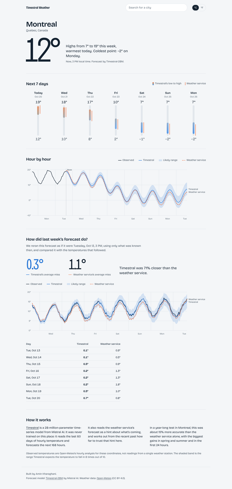
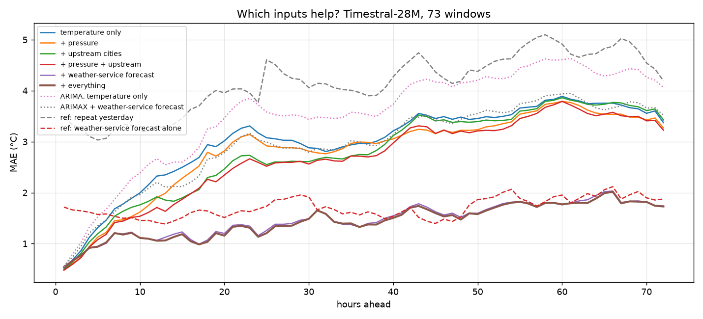
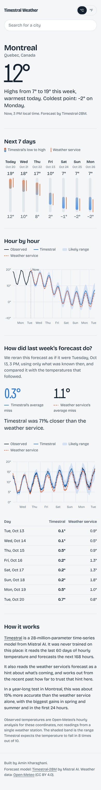
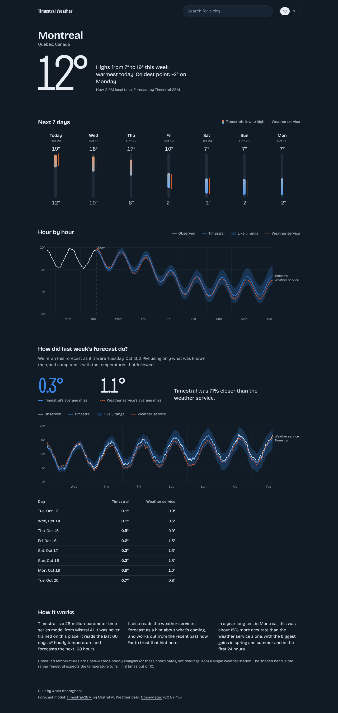

# Timestral Weather

Zero-shot temperature forecasting with [Timestral](https://mistral.ai/news/timestral), Mistral AI's
pretrained time-series foundation model: a year-long backtest against classical models and a
professional weather forecast, and a web app that forecasts the next 7 days for any city and
checks itself against what actually happened.

<!-- Live demo: add your Hugging Face Space link here -->


<sub>The web app (shown with sample data).</sub>

## Results

Hourly temperature in Montreal, forecast 72 hours ahead from 73 start points spread across a full
year (Oct 2025 to Oct 2026). Every model gets 60 days of history. Error is mean absolute error in °C;
lower is better.

| Approach | Day 1 | Day 2 | Day 3 | Overall |
|---|---|---|---|---|
| Repeat yesterday | 3.50 | 4.24 | 4.72 | 4.15 |
| ARIMA(2,1,1), fitted per window | 2.46 | 3.73 | 4.38 | 3.52 |
| **Timestral-28M**, temperature only | 2.17 | 3.14 | 3.65 | 2.99 |
| Timestral-28M + air pressure + upstream cities | 1.69 | 2.85 | 3.46 | 2.67 |
| Weather-service forecast alone (Open-Meteo) | 1.56 | 1.64 | 1.91 | 1.71 |
| ARIMAX + weather-service forecast | 2.04 | 3.09 | 3.71 | 2.95 |
| **Timestral-28M + weather-service forecast** | **1.09** | **1.50** | **1.80** | **1.46** |



**What I found**

- **Zero-shot beats a fitted classical model.** With nothing but past temperatures, Timestral, which
  never saw this data, was 15% more accurate than an ARIMA model fitted to each window.
- **The weather service's forecast is the input that matters.** Fed in as a known-future
  covariate, it cut Timestral's error in half. The result is 15% more accurate than the weather
  service's own forecast, 30% on day 1. ARIMAX given the same input couldn't use it well and ended
  up worse than the weather service alone.
- **The gain depends on the season.** Timestral corrects consistent local bias in the forecast:
  40% better than the weather service in summer, 10% in spring, 4% in autumn, and no gain in
  winter, when errors come from the timing of cold fronts that past temperatures can't predict.

  | Season | Timestral + forecast | Weather service alone |
  |---|---|---|
  | Winter | 2.02 | 1.98 |
  | Spring | 1.48 | 1.65 |
  | Summer | 1.15 | 1.93 |
  | Autumn | 1.21 | 1.26 |

- **Upstream cities and pressure help, until the forecast is added.** Temperatures in Ottawa,
  Toronto, Detroit and Chicago plus air pressure cut error 11% on their own, mostly on day 1. Once
  the weather-service forecast is included they add nothing, because the forecast already
  accounts for incoming weather.
- **Bigger isn't better here.** Timestral-209M was no more accurate than 28M and about 6× slower.
- **The uncertainty bands needed widening.** Raw 10–90% bands held only about 70% of outcomes once
  the forecast was added. Per-day widening factors of 1.08–1.28, fit on half the windows,
  brought held-out coverage to 74–81%.

Full numbers: [docs/results/backtest_28M_72h_1year.csv](docs/results/backtest_28M_72h_1year.csv).

**How the test stays fair.** Covariates like pressure and other cities' temperatures are past-only.
For the weather-service forecast, each future hour only uses a forecast issued at least that many
hours earlier, from Open-Meteo's archive of previous model runs, so nothing is used before it
existed. "Observed" temperatures are Open-Meteo's hourly reanalysis for the coordinates rather than a
single station's readings.

## What's here

| Folder | What it is |
|---|---|
| [`research/`](research/) | Backtests and the live forecast script behind the results above |
| [`webapp/`](webapp/) | The web app: FastAPI backend running Timestral, plus a no-build HTML/CSS/JS frontend, ready for Hugging Face Spaces |
| [`docs/`](docs/) | Charts, screenshots and result tables |

## Run it

Both parts use [uv](https://docs.astral.sh/uv/) and need Python 3.10+. Timestral runs on CPU, so
no GPU is needed.

```bash
# Web app, then open http://127.0.0.1:8000
cd webapp
uv run uvicorn main:app --reload

# Experiments
cd research
uv run python backtest_covariates.py    # the year-long comparison above (~2 min)
uv run python forecast_next.py          # next 3 days for Montreal, with a chart
```

Deployment steps for the app are in [`webapp/README.md`](webapp/README.md).

## The web app

Search any city to get Timestral's 7-day forecast, hour by hour with its likely range, next to the
weather service's. A "How did last week's forecast do?" section reruns the same forecast as of 7 days
ago, using only what was known then, and scores both against what happened.

<p>
  
  
</p>

## Credits

- [Timestral](https://github.com/mistralai/timestral) by Mistral AI (code Apache 2.0; weights under
  Mistral's Modified MIT license).
- Weather data from [Open-Meteo](https://open-meteo.com/) (CC BY 4.0), free for non-commercial use.

Built by Amin Kharaghani. Code in this repository is under the [MIT License](LICENSE).
