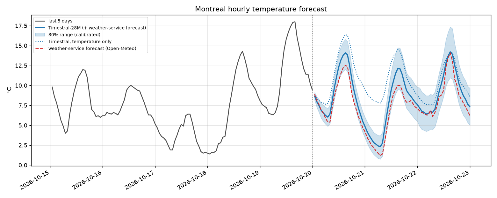
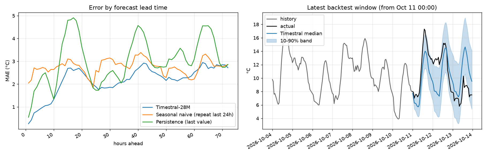

# Research

Experiments behind the results in the [main README](../README.md): zero-shot hourly temperature
forecasting for Montreal with Timestral, using free weather data from
[Open-Meteo](https://open-meteo.com) (no API key).

```bash
cd research
uv sync                                  # once: torch, timestral, pandas, matplotlib, statsmodels
uv run python backtest.py                # temperature only vs simple baselines
uv run python backtest_covariates.py     # which extra inputs help, over a full year
uv run python forecast_next.py           # live forecast for the next 72 h
```

Every script takes `--model 5M | 28M | 123M | 209M` (default 28M) and `--horizon <hours>`. Charts
and tables are written to `outputs/`, and downloaded data is cached in `data/`; both are recreated
on demand and not committed.

## Scripts

| Script | What it does |
|---|---|
| `weather.py` | Data helpers (Open-Meteo archive, previous forecast runs, live forecast) and a thin wrapper around `TimestralForecaster.forecast` |
| `backtest.py` | 30 forecast start points with 60 days of history each, scored against persistence and "repeat the last 24 h" |
| `backtest_covariates.py` | The main experiment: 73 start points across a year, comparing temperature only, + air pressure, + upstream cities (Ottawa, Toronto, Detroit, Chicago), + the weather-service forecast, and + everything, against ARIMA/ARIMAX, "repeat yesterday" and the weather-service forecast alone. Also reports error by season and calibrates the uncertainty band, saving `outputs/calibration_<model>.json` |
| `forecast_next.py` | Live forecast for Montreal using the winning setup, with the calibrated band if a calibration file exists. `--plain` uses temperature only |

## Example output

`forecast_next.py`: Timestral's 72-hour forecast for Montreal, the weather-service forecast, and the
temperature-only forecast for comparison.



`backtest.py`: temperature-only Timestral against two naive baselines, by hours ahead (left), and
one example forecast window (right).



## Method notes

- **Inputs.** Pressure and other cities' temperatures go in as `past_covariates`, which the model
  sees over the history only. The weather-service forecast goes in as a `known_covariate`,
  covering both the history and the forecast horizon.
- **No lookahead.** For an hour *h* hours after the start point, the weather-service forecast used
  is the one issued at least *h* hours before that hour (`temperature_2m_previous_dayN` with
  N = ⌈h/24⌉). Over the history, 1-day-old forecasts are used.
- **Below-zero temperatures.** Timestral clamps forecasts at 0 by default when the whole history
  is non-negative, which would rule out a frost after a mild October, so every call passes
  `clip_nonnegative=False`.
- **Calibration.** For each forecast day, the raw 10–90% band is widened around the median by the
  factor that makes 80% of outcomes fall inside it. The factor is fit on even windows and
  checked on odd ones.
- **ARIMA baseline.** ARIMA(2,1,1) with 3 Fourier pairs for the daily cycle, fit by statsmodels
  on each window's 60 days. ARIMAX adds the weather-service forecast as a regressor.
